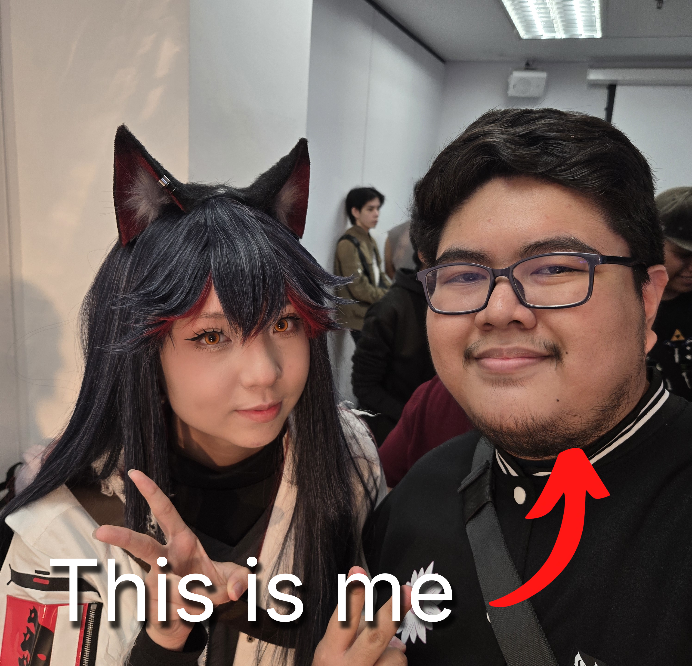

<!-- ✿ Banner ✿ -->

  

  

  
  
  

---

## 🌸 Introduction

Hi! I'm **Muhamad Hazim** (a.k.a. **hazzyxz**), a student in the
**Software Maintenance and Evolution** course. ✧*。

I expect to learn a lot about modern software maintenance practices and how
to work with legacy systems: the ancient scrolls of the codebase world. 📜

- 🎌 **Fun fact**: I enjoy going to anime and cosplay events in my free time.
- 📚 **Course expectations**: To gain hands-on experience in maintaining and
  evolving software.

  
   
  Me at a cosplay event with Texas (Arknights) cosplayer <a href="https://www.instagram.com/_akinokaze/">@_akinokaze</a>

  

